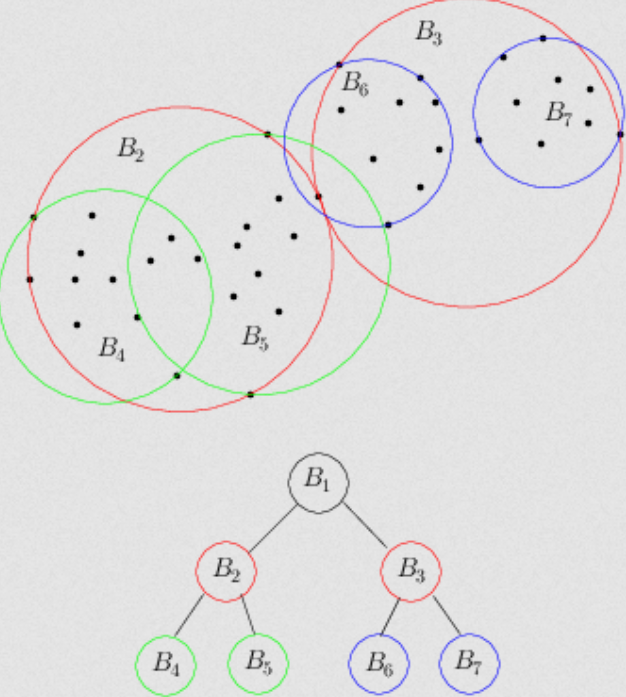

# KD & Ball Trees

<p align="center">
  
  <br>
  <small><i>Image source: https://www.lix.polytechnique.fr/~nielsen/BregmanProximity/bbtree-illustration.png</i></small>
</p>

## Table of Contents

- [KD & Ball Trees](#KD--Ball-Trees)
  - [Introduction](#introduction)
  - [Assumptions](#assumptions)
  - [Algorithm](#algorithm)
    - [KD Trees](#kd-trees)
    - [Ball Trees](#ball-trees)
  - [Usage](#usage)
  - [Results & Demo](#results--demo)

## Introduction

KD Trees and Ball Trees are data structures that can make KNN faster. Both recursively partition the data into smaller regions so that we do not have to compare a query point with every point in the dataset.

## Assumptions

Both methods follow the same assumptions as KNN, and hence also suffer from the curse of dimensionality.

Like KNN, Ball Trees can work well when the data has a low intrinsic dimensionality, even if the number of features is relatively large. KD Trees don't work with higher dimensions, even if the intrinsic dimensionality is low.

## Algorithm

### KD Trees

For KD trees, we first find the feature with the maximum spread. We then sort the data points according to that feature and split the data at the median value. The left and right partitions become two new nodes. We repeat this process recursively until we reach a stopping criterion, such as a minimum number of data points per leaf node. At that point, the node becomes a leaf node. 

During inference, we traverse the tree by comparing the query value in the splitting dimension with the node's median value to decide which side to explore first. Once we reach a leaf node, we find the K nearest neighbors among its points. We then backtrack through the tree and check whether the other side of each split could contain a closer neighbor. If the distance from the query point to the splitting hyperplane is greater than the distance to the current Kth nearest neighbor, we can prune that branch. Otherwise, we search it as well. Eventually, after exploring the necessary branches and pruning the others, we obtain the K nearest neighbors.

### Ball Trees

For Ball Trees, the overall idea is similar, but the way we partition the data is different. Instead of selecting a feature with the maximum variance, we find a direction along which the data has maximum variance. This direction does not necessarily have to align with one of the original feature dimensions. Once we find this direction, we project all the points onto it and sort them according to their projected values. We then split the points at the median, just as we do in a KD-tree.

For each resulting partition, we construct a bounding ball. We store the mean (center) of the points in the partition and the radius of the ball. The radius is calculated as the maximum distance from the center to any point in that partition. We recursively apply the same process to build the Ball Tree.

During inference, we again traverse the tree and first explore the branch that is more likely to contain the nearest neighbors. However, instead of checking the distance to a splitting hyperplane, as in a KD-tree, we use the distance from the query point to the bounding ball. If the minimum possible distance from the query point to any point inside a ball is greater than the distance to the current Kth nearest neighbor, we can prune that entire branch. Otherwise, we need to search it.

## Usage

To use the KD Tree, uncomment line `26` in `knn_fast.cpp`, which declares the KD Tree namespace, and comment out line `27`, which declares the Ball Tree namespace. To use the Ball Tree, do the opposite, i.e., uncomment line `27` and comment out line `26`. The function signatures are the same for both implementations, so the rest of the code does not need to change.

To compile the code, run the following command:

```
g++ knn_fast.cpp ../../../utils/csv.cpp ../../../utils/distances.cpp ../../../utils/metrics.cpp kd.cpp ball.cpp
```

## Results & Demo

One way to validate our implementation is to compare its predictions with vanilla KNN. The predictions should be the same because KD Trees and Ball Trees are simply data structures on top of KNN. They do not change the underlying algorithm.

Similar to KNN, we split the data into an 80:10:10 train-validation-test split and found `K = 33` with Euclidean distance to be optimal on the validation set. Using the same configuration, we obtained the following results on the test set for both algorithms:

```
MAE: 0.523629 
RMSE: 0.685546 
R2: 0.5643
```

The KD Tree implementation took `8664 ms`, compared to `12065 ms` for vanilla KNN. This gives a speedup of approximately `28%`, while producing the same predictions as vanilla KNN.

Sadly, the Ball Tree implementation took `17520 ms`, which is about `45%` slower than vanilla KNN. This could be due to a suboptimal implementation. 

We also ran the model on the same essay used for KNN. It achieved a score of 1.82.

`This is a test essay. Lets see where it goes! This is a poem from the family guy. Oh, squiggly line in my eye fluid, I see you lurking there on the periphery of my vision. But when I try to look at you, you scurry away. Are you shy, squiggly line? Why only when I ignore you, do you return to the center of my eye? Oh, squiggly line, it's alright, you are forgiven.`